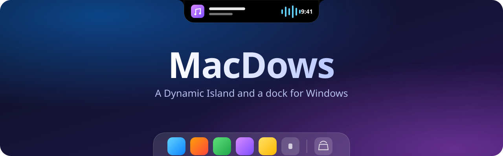

 

### [⬇️ Download MacDows](https://github.com/Fatal-IV/MacDows/releases/latest)

[Features](#features) · [Install](#install) · [Updates](#updates) · [Changelog](CHANGELOG.md) · [License](#license) · [Türkçe](#türkçe)

 

## Features

<table>
<tr>
<td width="50%" valign="top">

### 🏝️ Dynamic Island

A live island at the top of your screen.

- **Now playing** with cover art, progress and controls
- **Notifications** as banners, with a history
- **Control Center:** Wi-Fi, Bluetooth, VPN, volume, brightness
- **Power menu:** sleep, hibernate, restart, shut down
- **Clock, weather, timer** and a **shelf** for dropped files
- **Compact or Wide** layout, attached or floating

</td>
<td width="50%" valign="top">

### 🧭 Dock

A dock that knows your apps.

- **Pinned and running apps** with window previews
- **Recycle Bin** that accepts dropped files
- **Folder stacks:** Downloads and more fan out, the newest files one click away
- Opens a minimized program on the monitor you clicked

</td>
</tr>
<tr>
<td width="50%" valign="top">

### 🖥️ Made for your setup

- **Several monitors**, each with its own island and dock
- **Light and dark** themes, glass and material looks
- **English and Turkish**

</td>
<td width="50%" valign="top">

### ⚡ Light and safe

- Built with **Tauri, Rust and React**
- A guard process **puts your taskbar back** if MacDows ever stops
- Updates are **signed and verified** before they install

</td>
</tr>
</table>

 

## Install

| | |
|:-:|---|
| **1** | Download **`MacDows-Setup.exe`** from the [latest release](https://github.com/Fatal-IV/MacDows/releases/latest). |
| **2** | Run it and press **Install**. No administrator permission is needed. MacDows is installed for your user. |
| **3** | Press **Open MacDows**. The tray icon (in the hidden icons) opens Settings. |

> [!NOTE]
> The installer is not code-signed yet, so Windows SmartScreen may show an "unknown publisher" warning. Choose **More info → Run anyway**.

> [!TIP]
> MacDows needs the WebView2 runtime. Windows 11 already has it. If it is missing, the installer downloads and installs it first (internet required).

To remove MacDows, use **Windows Settings → Apps**.

 

## Updates

MacDows looks for a new release a little after it starts, and then every 12 hours.

1. A small **blue dot** appears on the island.
2. **Settings → Updates** shows what is new.
3. Nothing is installed until you press **Update and restart**.

Every update is verified with the MacDows signing key before it installs. The automatic check can be turned off in the same card.

 

## About this repository

This repository holds the **releases** and the **update feed** (`latest.json`). The source code is kept in a private repository, so there is nothing to build here.

See the [changelog](CHANGELOG.md) for what changed in each version.

 

## License

MacDows is **free to use**, for personal and commercial purposes. It may not be modified or redistributed. The full terms are in [LICENSE](LICENSE) and third-party credits in [NOTICE](NOTICE).

 

---

<b>🇹🇷 Türkçe</b>

 

**MacDows**, Windows için bir Dynamic Island ve dock'tur.

| | |
|---|---|
| **Ada** | Çalan müzik (kapak, ilerleme, kontroller), bildirimler ve geçmişi, Wi-Fi / Bluetooth / VPN sayfalı Denetim Merkezi, güç menüsü, saat, hava durumu, zamanlayıcı ve dosya rafı |
| **Dock** | Sabit ve çalışan uygulamalar, dosya bırakılabilen Geri Dönüşüm Kutusu, klasör yığınları |
| **Genel** | Birden fazla monitör, açık ve koyu tema, Türkçe ve İngilizce arayüz |

**Kurulum:** [Son sürümden](https://github.com/Fatal-IV/MacDows/releases/latest) `MacDows-Setup.exe` dosyasını indirin, çalıştırıp **Install**'a basın (yönetici izni gerekmez). Kurulum henüz imzalı olmadığı için SmartScreen uyarı verebilir: **Ek bilgi → Yine de çalıştır**.

**Güncelleme:** MacDows yeni sürümü kendisi bulur ve adada mavi bir nokta çıkar. Siz **Güncelle ve yeniden başlat**'a basmadan hiçbir şey kurulmaz. Güncellemeler imza anahtarıyla doğrulanır.

**Lisans:** Kişisel ve ticari olarak ücretsiz kullanılabilir; değiştirilemez ve yeniden dağıtılamaz. Ayrıntılar [LICENSE](LICENSE) dosyasında.

